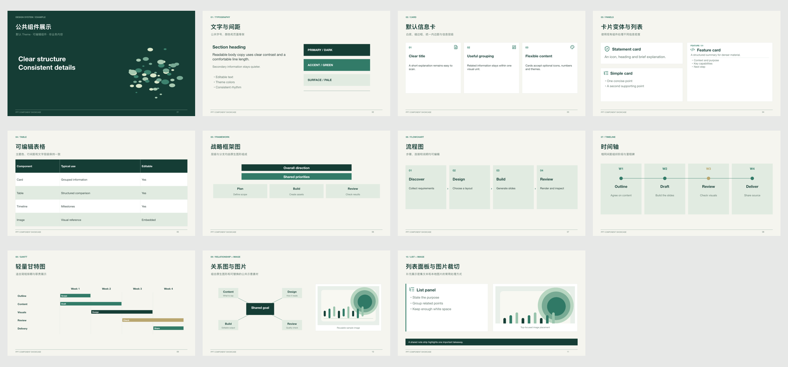

# Python PPT Workbench

用 Python 从源码生成可编辑的 PowerPoint。公共组件负责排版、表格和结构图；默认 Theme 提供统一的文字、颜色与间距，业务项目可以覆盖品牌参数并保留在本地。




上图来自 [Component Showcase](slides/example/build.py) 的真实渲染。展示稿覆盖文字、表格、图标、图片、流程图、时间轴、甘特图和关系图 等。


## Quick Start

需要 Python 3.11 或更新版本。先用 `python3 --version` 确认版本；若低于 3.11，将下列命令中的 `python3` 换成已安装的较新版本。在项目根目录运行：

```bash
python3 -m venv .venv
.venv/bin/python -m pip install -e .
.venv/bin/python slides/example/build.py
.venv/bin/python -m unittest discover -s code/tests -v
```

生成的 `slides/example/component_showcase.pptx` 可在 PowerPoint 中编辑；公共测试只使用公共代码和素材。这里的可编辑安装用于本地开发，不表示发布独立 Python Package。

## 组件与 Design System

| 公共能力 | 用途 |
| --- | --- |
| Typography、Shape、Card、Footer | 建立清晰的页面层级和一致的信息卡样式。 |
| Table、Icon、Image | 绘制可编辑表格，并嵌入本地图标与图片。 |
| Framework、Flowchart、Timeline、Gantt、Relationship | 用原生形状组织结构和流程。 |

[`DEFAULT` Theme](code/themes/theme.py) 延续已有的科学编辑风格，项目可用 `DEFAULT.override(colors=..., layout=..., type_scale=...)` 覆盖必要参数。组件接口见[公共组件文档](docs/components.md)，视觉规则见[设计系统](docs/design-system.md)，可运行的调用方式见[示例源码](slides/example/build.py)。

## 推荐流程

1. 先与 AI 或团队成员讨论受众、目标、核心思路、内容大纲和逐页描述，确认事实与素材。
2. 将确认后的需求填入下方 Prompt，或提供本地需求文档路径。
3. 在 `slides/<项目名>/build.py` 组织内容，调用公共组件；业务图片和品牌覆盖留在本地。
4. 从源码生成 PPTX，逐页渲染检查文字、布局和事实，再交付 PPTX、源码及预览。

### Example Prompt

> 请基于当前项目的公共 Library、默认 Theme 和 Component Showcase，设计并生成一份可编辑 PPT。先阅读 AGENTS.md 与 docs/00-index.md，复用现有组件；将业务内容和素材放在本地业务目录。生成后运行相关测试、逐页渲染检查，并说明使用的素材与待确认事项。
>
> {{请将已经讨论确认的 PPT 需求、核心思路、内容大纲、逐页描述及相关要求替换到这里。也可以提供对应的本地文档路径。}}

## 项目文档与资产边界

[文档索引](docs/00-index.md)提供[架构](docs/architecture.md)、[设计系统](docs/design-system.md)、[组件](docs/components.md)和[操作指南](docs/operations.md)的入口。

公共代码、`slides/example/build.py`、`assets/icons/` 和 `assets/shared/` 可作为共享项目使用。新的 `slides/<项目名>/`、`assets/images/`、`docs/projects/`、`references/` 与 `prototype/` 默认由 [`.gitignore`](.gitignore) 排除，供本地业务使用。忽略规则不会清除已经提交的文件；首次初始化或再次提交前，请按[共享检查步骤](docs/operations.md#git-共享检查)审阅待提交文件与历史。

## 许可证

仓库自身的代码目前没有声明开源许可证；对外开放复用前需要由项目所有者确定授权方式。随仓库保存的 Lucide SVG/PNG 图标涉及 ISC，部分源自 Feather 的图标还涉及 MIT；完整第三方许可见[图标许可文件](assets/icons/LICENSE)和[图标说明](assets/icons/README.md)。Python 依赖由安装命令单独获取。
